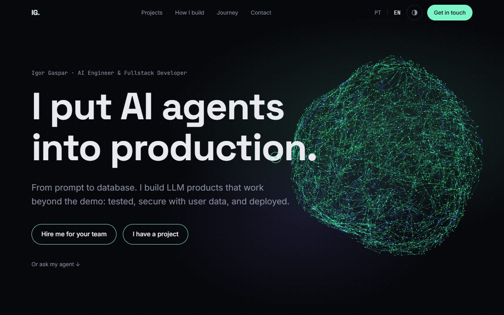
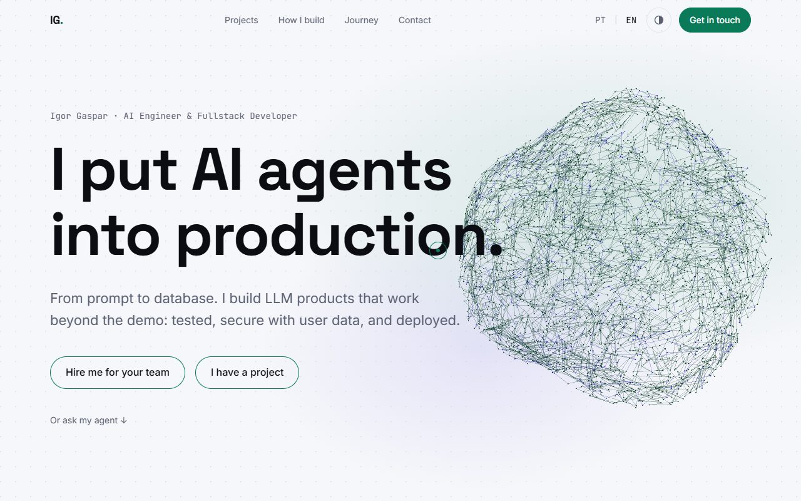
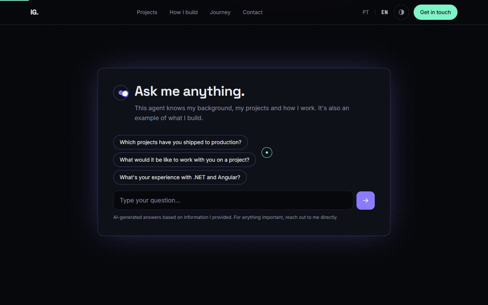
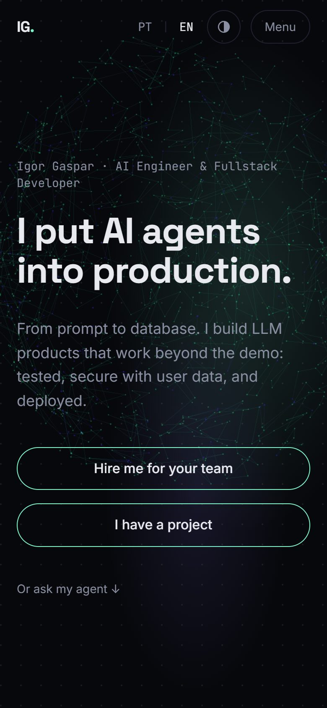
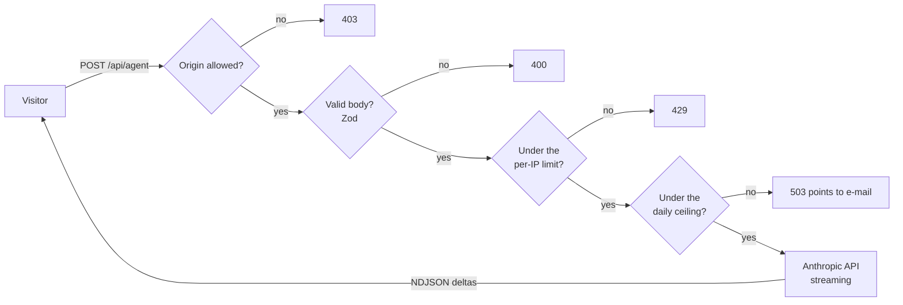

<div align="center">

# igorgaspar.tech

**A bilingual developer portfolio with a streaming AI agent, a WebGL neural core and scroll choreography that degrades gracefully.**

[Português](README.md) · **English**

[](https://github.com/IgorGaspar/portfolio/actions/workflows/ci.yml)
[](https://igorgaspar.tech)
[](LICENSE)




</div>

Not a template with the lorem ipsum swapped out: it is the production site of a working engineer, with the parts that usually get skipped done properly. Read it as a reference for how to ship an LLM feature, a heavy 3D hero and an animated page without giving up accessibility, performance or your API bill.

## Highlights

| | |
|---|---|
| **An agent you can talk to** | A Route Handler streams answers from the Anthropic API as NDJSON. Origin check, Zod validation, per-IP rate limit and a site-wide daily ceiling sit in front of the model, and the call is cancelled when the visitor closes the chat. The key never reaches the browser. |
| **3D that earns its bytes** | One fixed React Three Fiber canvas serves the hero and the contact section. It loads on the first user input, grows from a single point, pauses off screen and falls back to a pre-rendered image on weak devices or under reduced motion. |
| **Motion in three levels** | Full on desktop, light on touch screens, fades-only for `prefers-reduced-motion`. Driven by `data-*` attributes (GSAP, ScrollTrigger, SplitText, Lenis) in its own lazy chunk, so the content never depends on it. |
| **Fast by construction** | The hero is painted from CSS alone, CSS is inlined, fonts are not preloaded, and the JavaScript for the scene and the choreography waits for idle. Mobile Lighthouse scores 92-94 in the default run, with a real-throttling LCP of about 1.1-1.4 s. |
| **Accessible** | AA contrast in both themes, visible focus, a keyboard-operable chat dialog that returns focus to its opener, pinned sections that never trap focus, and zero axe violations in the automated audit. |
| **Bilingual and indexable** | The portfolio exists in both languages (`/sobre` ↔ `/en`, with `hreflang`), generated Open Graph images, Person JSON-LD, `robots.txt` and `sitemap.xml`. Portuguese-only pages declare just their canonical. |
| **Showcase and portfolio, apart** | `/` is the showcase of my products and services for clients (Portuguese only, a light hero without WebGL). The portfolio lives at `/sobre`, with its English version at `/en`. |
| **A sales page on the same stack** | [`/robo-de-ofertas`](https://igorgaspar.tech/robo-de-ofertas) sells my WhatsApp offers bot as a managed service. Portuguese only (the English route is a 404 on purpose), with its own metadata, Service JSON-LD with monthly offers, WhatsApp CTAs with a prefilled message, and the same motion, themes and axe audits as the portfolio. |

<table>
  <tr>
    <td width="42%"></td>
    <td width="42%"></td>
    <td width="16%"></td>
  </tr>
  <tr>
    <td align="center"><sub>Light theme: the scene recolours from the design tokens.</sub></td>
    <td align="center"><sub>The agent, with suggested questions.</sub></td>
    <td align="center"><sub>Phone.</sub></td>
  </tr>
</table>

## How the agent request flows



Every refusal is a short message in the visitor's language that points to e-mail, so the chat never ends in a dead end.

## Stack

Next.js 16 (App Router) · React 19 · TypeScript · Tailwind CSS v4 · GSAP + ScrollTrigger + SplitText · Lenis · Motion · React Three Fiber / three.js · Anthropic SDK · Zod · Vitest · Playwright · axe-core · Docker

## Quick start

Requires Node 22.

```bash
git clone https://github.com/IgorGaspar/portfolio.git
cd portfolio
npm install
cp .env.example .env.local   # then fill in ANTHROPIC_API_KEY
npm run dev
```

Open http://localhost:3000. Without the private agent prompt (see below) the agent runs on the generic templates in `content/agent/*.example.md`, so everything works out of the box.

### Environment

Server-side only. Nothing here is ever prefixed with `NEXT_PUBLIC_`.

| Variable | Purpose |
|---|---|
| `ANTHROPIC_API_KEY` | Key for the agent route |
| `ANTHROPIC_MODEL` | Model used by the agent (defaults to Claude Haiku 4.5) |
| `AGENT_RATE_LIMIT_MAX`, `AGENT_RATE_LIMIT_WINDOW` | Requests per IP and window (default 20 per hour) |
| `AGENT_DAILY_LIMIT` | Site-wide ceiling of agent calls per UTC day (default 200). Past it the agent points visitors to e-mail |
| `SITE_ENV` | `staging` on the staging deploy: `noindex` on every response and a `robots.txt` that blocks everything. Read at build time, so it must be a build variable too. Leave empty in production |

### Scripts

| Command | What it does |
|---|---|
| `npm run dev` | Development server |
| `npm run build` / `npm start` | Production build and server |
| `npm run lint` / `npm run typecheck` | ESLint and `tsc --noEmit` |
| `npm test` | Vitest: agent library, route handler and chat store, with the SDK mocked |
| `npm run test:e2e` | Playwright: smoke tests, keyboard navigation, axe audits and the reduced-motion path. The agent API is always mocked |
| `npm run eval:agent` | Sends a fixed question set to the real model. **Spends API credit** |

## Use it as a base

You are welcome to start from this code. What to change:

1. **Copy and projects:** `content/pt.ts`, `content/en.ts` and `content/projects.ts` (typed dictionaries, one per language).
2. **Identity:** `siteUrl` in `lib/i18n.ts`, the metadata in `app/[locale]/layout.tsx`, the Open Graph image in `app/[locale]/opengraph-image.tsx`.
3. **Media:** `public/media/` and `assets/` (see `assets/README.md`). After changing the look of the 3D scene, regenerate the static fallbacks with `node scripts/render-neural-fallback.mjs`.
4. **The agent:** copy `content/agent/instructions.example.md` to `instructions.md` and `knowledge.example.md` to `knowledge.md`, then fill them in. Both are git-ignored on purpose, so a public repository does not publish your agent's rules.

## Project layout

```
app/             routes (showcase at /, portfolio at /sobre and /en, the /robo-de-ofertas sales page), the agent Route Handler, health check, robots, sitemap
components/      sections, agent chat, 3D scene, architecture diagrams, sales page, layout and UI
content/         typed pt/en dictionaries, project data, sales page copy and plans, agent prompt templates
lib/             agent, rate limit, i18n, scroll choreography
e2e/             Playwright specs
tests/           Vitest specs
scripts/         agent evaluation and static fallback rendering
```

## Engineering notes

A few decisions worth reading before you copy them:

- **The prompt is deployment config, not source.** `instructions.md` and `knowledge.md` are mounted into the container at `/app/content/agent/`. Outside production a missing file falls back to its `.example.md`; in production it is an error, so the agent can never silently run on a template.
- **The client IP is the last `x-forwarded-for` entry.** The site sits behind one proxy that appends the address it saw. Earlier entries are client-supplied and forgeable, and trusting them would let anyone bypass the rate limit with a new fake IP per request.
- **The 3D canvas never takes pointer events.** React Three Fiber's wrapper catches clicks unless told otherwise, which silently covered the page's buttons while the canvas was raised above them. A regression test checks it.
- **Motion has a floor.** Every effect has a path under `prefers-reduced-motion`, and the resting state of the page is always the complete content.
- **Counters live in memory.** The site runs as a single instance, so the rate limiter and the daily ceiling need no shared store. Run several replicas and you will want Redis.

## Deployment

The app builds with `output: "standalone"` and ships as a container (`Dockerfile`: Node 22 Alpine, non-root user, healthcheck on `/api/health`). It runs on a VPS managed by [Coolify](https://coolify.io), which handles routing and HTTPS. Any container host works the same way: expose port 3000, set the environment variables as runtime variables, and mount the two agent prompt files.

### Branches and environments

| Branch | Environment | Purpose |
|---|---|---|
| `main` | Production, `igorgaspar.tech` | Only takes merges from `develop`, once validated on staging |
| `develop` | Staging, with `SITE_ENV=staging` | Where changes are integrated and tested live |
| `feat/*`, `fix/*` | Local | One branch per change, cut from `develop`, with a PR into `develop` |

CI (lint, typecheck, unit tests, build and e2e) runs on every PR and on each push to `main` and `develop`. To promote, open a PR from `develop` into `main`.

## License

The **code** is released under the [MIT License](LICENSE): use it, change it, ship it, and keep the copyright notice.

The **content** (copy, project descriptions, images and the author's identity) is not covered by that license and stays © Igor Gaspar. See [LICENSE-CONTENT.md](LICENSE-CONTENT.md).

## Author

**Igor Gaspar**, AI engineer and fullstack developer.
[igorgaspar.tech](https://igorgaspar.tech) · [LinkedIn](https://www.linkedin.com/in/igorfgaspar) · [GitHub](https://github.com/IgorGaspar)

If this repository helped you, a star is the kindest way to say so.
