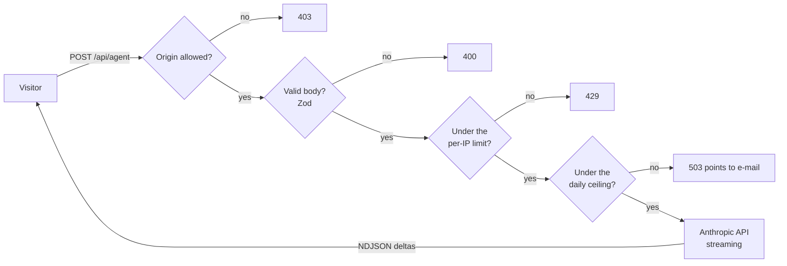

<div align="center">

# igorgaspar.tech

**The code behind my website: a portfolio in Portuguese and English, with an AI agent that answers questions about me, a 3D neural core and animations that adapt to every device.**

[Português](README.md) · **English**

[](https://github.com/IgorGaspar/portfolio/actions/workflows/ci.yml)
[](https://igorgaspar.tech)
[](LICENSE)


</div>

Hi, I'm Igor! This is the code for the site where I present my work, and it's live at [igorgaspar.tech](https://igorgaspar.tech). If you'd like to see the result before reading the code, start there and ask the agent a question.

Here you'll find the parts portfolios usually leave out: how to put an LLM feature in production, a heavy 3D hero and a page full of animations without giving up accessibility, performance or control of your API bill. Feel free to read it as a reference, copy what's useful or use the whole project as a starting point.

## What's worth a look

| | |
|---|---|
| **An agent you can really talk to** | Answers arrive in real time: a Route Handler streams the Anthropic API's output as NDJSON. Before reaching the model, each request goes through an origin check, Zod validation, a per-IP rate limit and a site-wide daily ceiling. If the visitor closes the chat, the call is cancelled. And the key never reaches the browser. |
| **3D that earns its bytes** | One fixed React Three Fiber canvas serves the hero and the contact section. It loads on the first user input, grows from a single point and pauses off screen. On weak devices or under reduced motion, it gives way to a pre-rendered image. |
| **Motion that fits each device** | There are three levels: full on desktop, light on touch screens and fades-only for `prefers-reduced-motion`. Everything is driven by `data-*` attributes (GSAP, ScrollTrigger, SplitText, Lenis) in its own lazy chunk, so the content never depends on the animations. |
| **Fast from the ground up** | The hero is painted from CSS alone, CSS is inlined, fonts are not preloaded, and the JavaScript for the scene and the choreography waits for idle. Mobile Lighthouse scores 92-94 in the default run, with a real-throttling LCP of about 1.1-1.4 s. |
| **Accessible to whoever arrives** | AA contrast in both themes, visible focus, a keyboard-operable chat that returns focus to its opener, pinned sections that never trap focus, and zero axe violations in the automated audit. |
| **In two languages and easy to find** | Portuguese at `/`, English at `/en`, per-locale metadata and `hreflang`, generated Open Graph images, Person JSON-LD, `robots.txt` and `sitemap.xml`. |
| **A sales page on the same stack** | At [`/robo-de-ofertas`](https://igorgaspar.tech/robo-de-ofertas) I sell my WhatsApp offers bot as a managed service. The page is Portuguese only (the English route is a 404 on purpose), with its own metadata, Service JSON-LD with monthly offers, WhatsApp CTAs with a prefilled message, and the same motion, themes and axe audits as the portfolio. |

<table>
  <tr>
    <td width="42%"></td>
    <td width="42%"></td>
    <td width="16%"></td>
  </tr>
  <tr>
    <td align="center"><sub>In the light theme, the scene recolours from the design tokens.</sub></td>
    <td align="center"><sub>The agent comes with suggested questions.</sub></td>
    <td align="center"><sub>And on a phone.</sub></td>
  </tr>
</table>

## The path of a question to the agent



When the agent has to refuse, the visitor gets a short message in their own language that points to e-mail. That way the conversation never ends in a dead end.

## What it's made with

Next.js 16 (App Router) · React 19 · TypeScript · Tailwind CSS v4 · GSAP + ScrollTrigger + SplitText · Lenis · Motion · React Three Fiber / three.js · Anthropic SDK · Zod · Vitest · Playwright · axe-core · Docker

## Run it on your machine

All you need is Node 22.

```bash
git clone https://github.com/IgorGaspar/portfolio.git
cd portfolio
npm install
cp .env.example .env.local   # then fill in ANTHROPIC_API_KEY
npm run dev
```

Then just open http://localhost:3000. The agent's private prompt isn't in the repository (I explain why below), but that's fine: without it, the agent uses the generic templates in `content/agent/*.example.md`, and everything works out of the box.

### Environment variables

They all stay on the server: nothing here is ever prefixed with `NEXT_PUBLIC_`.

| Variable | Purpose |
|---|---|
| `ANTHROPIC_API_KEY` | Key for the agent route |
| `ANTHROPIC_MODEL` | Model used by the agent (defaults to Claude Haiku 4.5) |
| `AGENT_RATE_LIMIT_MAX`, `AGENT_RATE_LIMIT_WINDOW` | Requests per IP and window (default 20 per hour) |
| `AGENT_DAILY_LIMIT` | Site-wide ceiling of agent calls per UTC day (default 200). Past it the agent points visitors to e-mail |

### Scripts

| Command | What it does |
|---|---|
| `npm run dev` | Development server |
| `npm run build` / `npm start` | Production build and server |
| `npm run lint` / `npm run typecheck` | ESLint and `tsc --noEmit` |
| `npm test` | Vitest: agent library, route handler and chat store, with the SDK mocked |
| `npm run test:e2e` | Playwright: smoke tests, keyboard navigation, axe audits and the reduced-motion path. The agent API is always mocked |
| `npm run eval:agent` | Sends a fixed question set to the real model. **Heads up: it spends API credit** |

## Want to use it as a base?

Go right ahead! These are the places to make the project your own:

1. **Copy and projects:** `content/pt.ts`, `content/en.ts` and `content/projects.ts` (typed dictionaries, one per language).
2. **Identity:** `siteUrl` in `lib/i18n.ts`, the metadata in `app/[locale]/layout.tsx` and the Open Graph image in `app/[locale]/opengraph-image.tsx`.
3. **Media:** `public/media/` and `assets/` (see `assets/README.md`). If you change the look of the 3D scene, regenerate the static fallbacks with `node scripts/render-neural-fallback.mjs`.
4. **The agent:** copy `content/agent/instructions.example.md` to `instructions.md` and `knowledge.example.md` to `knowledge.md`, then fill them in. Both are git-ignored on purpose, so a public repository doesn't expose your agent's rules.

## How the project is organised

```
app/             routes (portfolio and the /robo-de-ofertas sales page), the agent Route Handler, health check, robots, sitemap
components/      sections, agent chat, 3D scene, architecture diagrams, sales page, layout and UI
content/         typed pt/en dictionaries, project data, sales page copy and plans, agent prompt templates
lib/             agent, rate limit, i18n, scroll choreography
e2e/             Playwright specs
tests/           Vitest specs
scripts/         agent evaluation and static fallback rendering
```

## Decisions worth a conversation

A few choices I'd explain to anyone thinking of copying them:

- **The prompt is deployment config, not source.** `instructions.md` and `knowledge.md` are mounted into the container at `/app/content/agent/`. Outside production, a missing file falls back to its `.example.md`. In production it's an error, so the agent can never silently run on a template.
- **The client IP is the last `x-forwarded-for` entry.** The site sits behind one proxy that appends the address it saw. Earlier entries are client-supplied and can be forged: if I trusted them, anyone could bypass the rate limit with a fake IP per request.
- **The 3D canvas never takes pointer events.** Unless told otherwise, React Three Fiber's wrapper catches clicks, and that silently covered the page's buttons while the canvas was raised above them. A regression test takes care of it.
- **Motion has a floor.** Every effect has a path under `prefers-reduced-motion`, and the resting state of the page is always the complete content.
- **Counters live in memory.** The site runs as a single instance, so the rate limiter and the daily ceiling need no shared store. With several replicas, you'll want Redis.

## How it goes live

The app builds with `output: "standalone"` and runs as a container (`Dockerfile`: Node 22 Alpine, non-root user, healthcheck on `/api/health`). Mine lives on a VPS managed by [Coolify](https://coolify.io), which handles routing and HTTPS. Any container host works the same way: expose port 3000, set the environment variables as runtime variables, and mount the two agent prompt files.

## License

The **code** is under the [MIT License](LICENSE): use it, change it and ship it, keeping the copyright notice.

The **content** (copy, project descriptions, images and the author's identity) isn't covered by that license and stays © Igor Gaspar. The details are in [LICENSE-CONTENT.md](LICENSE-CONTENT.md).

## Let's talk?

I'm **Igor Gaspar**, an AI engineer and fullstack developer. If you'd like to talk about this project or one of your own, here's where to find me:
[igorgaspar.tech](https://igorgaspar.tech) · [LinkedIn](https://www.linkedin.com/in/igorfgaspar) · [GitHub](https://github.com/IgorGaspar)

And if this repository helped you, leave a star. It's the kindest way to let me know!
