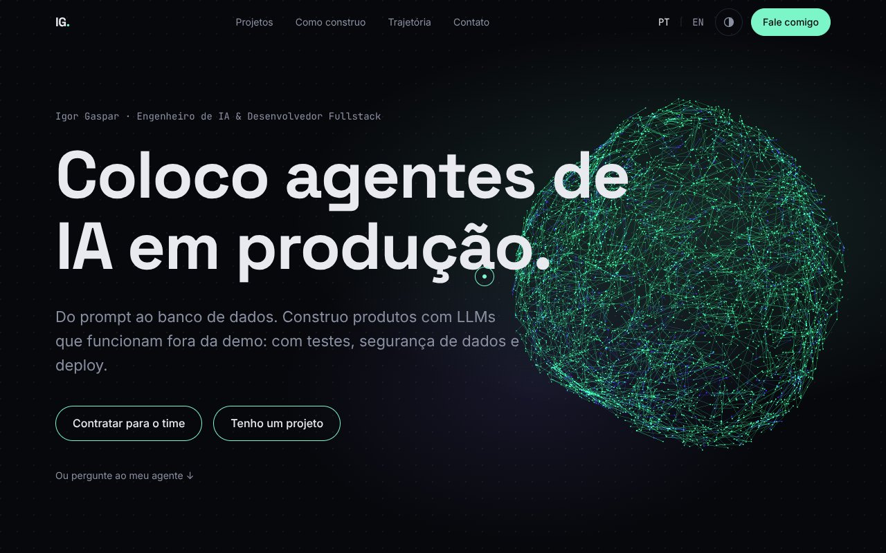
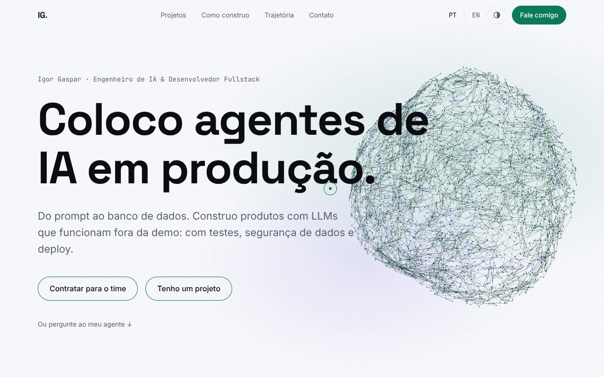
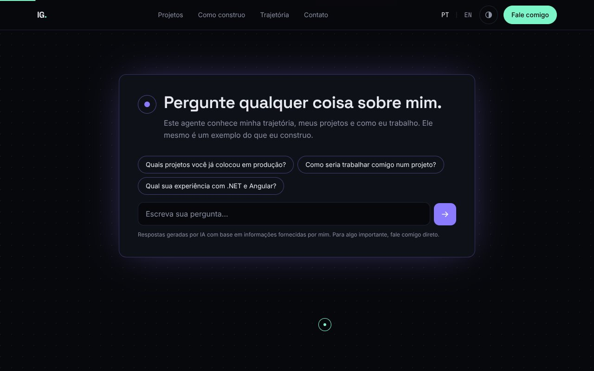
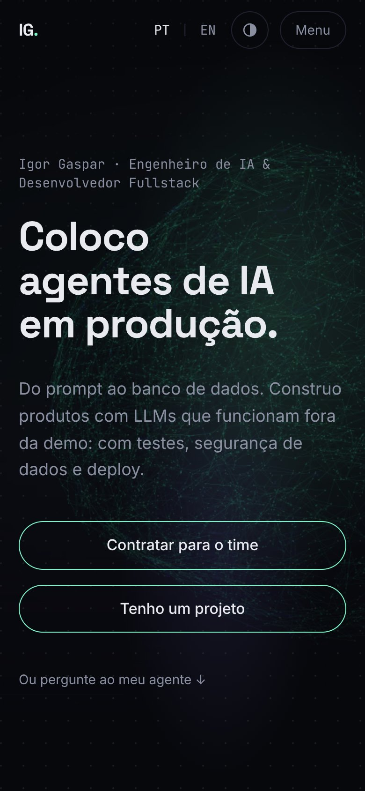
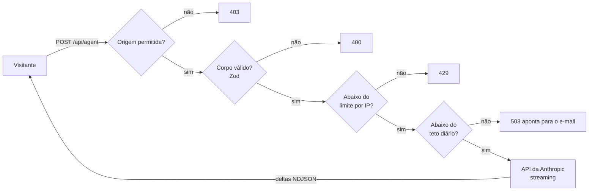

<div align="center">

# igorgaspar.tech

**O código do meu site: um portfólio em português e inglês, com um agente de IA que responde sobre mim, um núcleo neural em 3D e animações que se adaptam a cada aparelho.**

**Português** · [English](README.en.md)

[](https://github.com/IgorGaspar/portfolio/actions/workflows/ci.yml)
[](https://igorgaspar.tech)
[](LICENSE)




</div>

Oi, eu sou o Igor! Este é o código do site onde apresento meu trabalho, e ele está no ar em [igorgaspar.tech](https://igorgaspar.tech). Se quiser ver o resultado antes de ler o código, comece por lá e faça uma pergunta ao agente.

Aqui você encontra as partes que costumam ficar de fora dos portfólios: como colocar uma funcionalidade com LLM em produção, um hero 3D pesado e uma página cheia de animações sem abrir mão de acessibilidade, de desempenho nem do controle da fatura de API. Fique à vontade para ler como referência, copiar o que servir ou usar o projeto inteiro como ponto de partida.

## O que vale olhar por aqui

| | |
|---|---|
| **Um agente para conversar de verdade** | As respostas chegam em tempo real: um Route Handler transmite a saída da API da Anthropic em NDJSON. Antes de chegar ao modelo, cada pedido passa por verificação de origem, validação com Zod, limite por IP e um teto diário do site inteiro. Se o visitante fecha o chat, a chamada é cancelada. E a chave nunca chega ao navegador. |
| **3D que justifica os bytes** | Um único canvas React Three Fiber fixo atende o hero e a seção de contato. Ele carrega na primeira interação, cresce a partir de um ponto e pausa fora da tela. Em aparelhos fracos ou com movimento reduzido, dá lugar a uma imagem pré-renderizada. |
| **Movimento na medida de cada aparelho** | São três níveis: completo no desktop, leve em telas de toque e só fades para `prefers-reduced-motion`. Tudo é guiado por atributos `data-*` (GSAP, ScrollTrigger, SplitText, Lenis) em um chunk próprio e preguiçoso, então o conteúdo nunca depende das animações. |
| **Rápido desde a base** | O hero é pintado só com CSS, o CSS vai inline, as fontes não são pré-carregadas e o JavaScript da cena e da coreografia espera o idle. O Lighthouse mobile marca 92-94 na execução padrão, com LCP real (throttling real) de cerca de 1,1-1,4 s. |
| **Acessível para quem chega** | Contraste AA nos dois temas, foco visível, chat operável por teclado que devolve o foco a quem o abriu, seções fixadas que nunca prendem o foco e zero violações do axe na auditoria automatizada. |
| **Em dois idiomas e fácil de encontrar** | Português em `/`, inglês em `/en`, metadados e `hreflang` por idioma, imagens Open Graph geradas, JSON-LD de Person, `robots.txt` e `sitemap.xml`. |
| **Uma página de vendas na mesma base** | Em [`/robo-de-ofertas`](https://igorgaspar.tech/robo-de-ofertas) eu vendo meu robô de ofertas para WhatsApp como serviço gerenciado. A página é só em português (a rota em inglês dá 404 de propósito), com metadados próprios, JSON-LD de Service com ofertas mensais, CTAs para o WhatsApp com mensagem pronta e o mesmo motion, temas e auditorias axe do portfólio. |

<table>
  <tr>
    <td width="42%"></td>
    <td width="42%"></td>
    <td width="16%"></td>
  </tr>
  <tr>
    <td align="center"><sub>No tema claro, a cena troca de cor a partir dos design tokens.</sub></td>
    <td align="center"><sub>O agente já chega com perguntas sugeridas.</sub></td>
    <td align="center"><sub>E no celular.</sub></td>
  </tr>
</table>

## O caminho de uma pergunta ao agente



Quando o agente precisa recusar, o visitante recebe uma mensagem curta, no idioma dele, que aponta para o e-mail. Assim a conversa nunca termina num beco sem saída.

## Com o que foi feito

Next.js 16 (App Router) · React 19 · TypeScript · Tailwind CSS v4 · GSAP + ScrollTrigger + SplitText · Lenis · Motion · React Three Fiber / three.js · Anthropic SDK · Zod · Vitest · Playwright · axe-core · Docker

## Para rodar na sua máquina

Você só precisa do Node 22.

```bash
git clone https://github.com/IgorGaspar/portfolio.git
cd portfolio
npm install
cp .env.example .env.local   # depois preencha ANTHROPIC_API_KEY
npm run dev
```

Depois é só abrir http://localhost:3000. O prompt privado do agente não vem no repositório (explico abaixo), mas não tem problema: sem ele, o agente usa os modelos genéricos em `content/agent/*.example.md`, e tudo funciona de primeira.

### Variáveis de ambiente

Todas ficam só no servidor: nada aqui recebe o prefixo `NEXT_PUBLIC_`.

| Variável | Para que serve |
|---|---|
| `ANTHROPIC_API_KEY` | Chave usada pela rota do agente |
| `ANTHROPIC_MODEL` | Modelo usado pelo agente (padrão: Claude Haiku 4.5) |
| `AGENT_RATE_LIMIT_MAX`, `AGENT_RATE_LIMIT_WINDOW` | Requisições por IP e janela (padrão: 20 por hora) |
| `AGENT_DAILY_LIMIT` | Teto de chamadas ao agente por dia UTC, para o site inteiro (padrão: 200). Acima disso, o agente encaminha os visitantes ao e-mail |

### Scripts

| Comando | O que faz |
|---|---|
| `npm run dev` | Servidor de desenvolvimento |
| `npm run build` / `npm start` | Build e servidor de produção |
| `npm run lint` / `npm run typecheck` | ESLint e `tsc --noEmit` |
| `npm test` | Vitest: biblioteca do agente, route handler e store do chat, com o SDK mockado |
| `npm run test:e2e` | Playwright: testes de fumaça, navegação por teclado, auditorias axe e o caminho de movimento reduzido. A API do agente é sempre mockada |
| `npm run eval:agent` | Envia um conjunto fixo de perguntas ao modelo real. **Atenção: gasta crédito de API** |

## Quer usar como base?

Pode ficar à vontade! Estes são os pontos para deixar o projeto com a sua cara:

1. **Textos e projetos:** `content/pt.ts`, `content/en.ts` e `content/projects.ts` (dicionários tipados, um por idioma).
2. **Identidade:** `siteUrl` em `lib/i18n.ts`, os metadados em `app/[locale]/layout.tsx` e a imagem Open Graph em `app/[locale]/opengraph-image.tsx`.
3. **Mídia:** `public/media/` e `assets/` (veja `assets/README.md`). Se mudar o visual da cena 3D, regenere os fallbacks estáticos com `node scripts/render-neural-fallback.mjs`.
4. **O agente:** copie `content/agent/instructions.example.md` para `instructions.md` e `knowledge.example.md` para `knowledge.md`, e preencha. Os dois estão no `.gitignore` de propósito, para que um repositório público não exponha as regras do seu agente.

## Como o projeto está organizado

```
app/             rotas (portfólio e a página de vendas /robo-de-ofertas), o Route Handler do agente, health check, robots, sitemap
components/      seções, chat do agente, cena 3D, diagramas de arquitetura, página de vendas, layout e UI
content/         dicionários pt/en tipados, dados dos projetos, textos e planos da página de vendas, modelos do prompt do agente
lib/             agente, rate limit, i18n, coreografia de rolagem
e2e/             specs do Playwright
tests/           specs do Vitest
scripts/         avaliação do agente e renderização dos fallbacks estáticos
```

## Decisões que valem uma conversa

Algumas escolhas que eu explicaria para quem pensa em copiá-las:

- **O prompt é configuração de deploy, não código-fonte.** `instructions.md` e `knowledge.md` são montados no contêiner em `/app/content/agent/`. Fora de produção, um arquivo ausente cai para o seu `.example.md`. Em produção é erro, para que o agente nunca rode em silêncio com um modelo genérico.
- **O IP do cliente é a última entrada de `x-forwarded-for`.** O site fica atrás de um proxy que acrescenta o endereço que viu. As entradas anteriores vêm do cliente e podem ser forjadas: se eu confiasse nelas, qualquer um burlaria o limite com um IP falso a cada requisição.
- **O canvas 3D nunca recebe eventos de ponteiro.** Se não for instruído do contrário, o wrapper do React Three Fiber captura os cliques, e isso cobria em silêncio os botões da página quando o canvas estava acima deles. Um teste de regressão cuida disso.
- **O movimento tem um piso.** Todo efeito tem um caminho sob `prefers-reduced-motion`, e o estado de repouso da página é sempre o conteúdo completo.
- **Os contadores ficam em memória.** O site roda como uma única instância, então o limitador e o teto diário dispensam um armazenamento compartilhado. Com várias réplicas, você vai querer Redis.

## Como vai para o ar

O app compila com `output: "standalone"` e roda em um contêiner (`Dockerfile`: Node 22 Alpine, usuário sem privilégios, healthcheck em `/api/health`). O meu está em uma VPS gerenciada pelo [Coolify](https://coolify.io), que cuida do roteamento e do HTTPS. Qualquer host de contêiner funciona do mesmo jeito: exponha a porta 3000, defina as variáveis de ambiente como variáveis de runtime e monte os dois arquivos de prompt do agente.

## Licença

O **código** está sob a [Licença MIT](LICENSE): use, altere e publique, mantendo o aviso de copyright.

O **conteúdo** (textos, descrições de projetos, imagens e a identidade do autor) não entra nessa licença e continua © Igor Gaspar. Os detalhes estão em [LICENSE-CONTENT.md](LICENSE-CONTENT.md).

## Vamos conversar?

Sou **Igor Gaspar**, engenheiro de IA e desenvolvedor fullstack. Se quiser falar sobre este projeto ou sobre um projeto seu, me encontre aqui:
[igorgaspar.tech](https://igorgaspar.tech) · [LinkedIn](https://www.linkedin.com/in/igorfgaspar) · [GitHub](https://github.com/IgorGaspar)

E se este repositório te ajudou, deixe uma estrela. É o jeito mais gentil de me contar!
