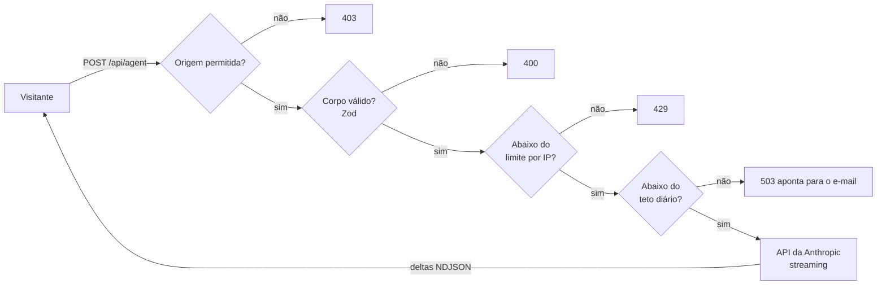

<div align="center">

# igorgaspar.tech

**Um portfólio de desenvolvedor bilíngue, com agente de IA em streaming, núcleo neural em WebGL e coreografia de rolagem que degrada com elegância.**

[English](README.md) · **Português**

[](https://github.com/IgorGaspar/portfolio/actions/workflows/ci.yml)
[](https://igorgaspar.tech)
[](LICENSE)


</div>

Não é um template com o lorem ipsum trocado: é o site em produção de um engenheiro em atividade, com bem feitas as partes que costumam ser puladas. Leia como referência de como entregar uma funcionalidade com LLM, um hero 3D pesado e uma página animada sem abrir mão de acessibilidade, desempenho ou da sua fatura de API.

## Destaques

| | |
|---|---|
| **Um agente com quem se conversa** | Um Route Handler transmite as respostas da API da Anthropic em NDJSON. Verificação de origem, validação com Zod, limite por IP e um teto diário do site inteiro ficam na frente do modelo, e a chamada é cancelada quando o visitante fecha o chat. A chave nunca chega ao navegador. |
| **3D que justifica os bytes** | Um único canvas React Three Fiber fixo atende o hero e a seção de contato. Carrega na primeira interação do usuário, cresce a partir de um ponto, pausa fora da tela e cai para uma imagem pré-renderizada em dispositivos fracos ou com movimento reduzido. |
| **Movimento em três níveis** | Completo no desktop, leve em telas de toque, apenas fades para `prefers-reduced-motion`. Guiado por atributos `data-*` (GSAP, ScrollTrigger, SplitText, Lenis) em um chunk próprio e preguiçoso, então o conteúdo nunca depende dele. |
| **Rápido por construção** | O hero é pintado só com CSS, o CSS vai inline, as fontes não são pré-carregadas, e o JavaScript da cena e da coreografia espera o idle. O Lighthouse mobile marca 92-94 na execução padrão, com LCP real (throttling real) de cerca de 1,1-1,4 s. |
| **Acessível** | Contraste AA nos dois temas, foco visível, diálogo de chat operável por teclado que devolve o foco a quem o abriu, seções fixadas que nunca prendem o foco e zero violações do axe na auditoria automatizada. |
| **Bilíngue e indexável** | Português em `/`, inglês em `/en`, metadados e `hreflang` por idioma, imagens Open Graph geradas, JSON-LD de Person, `robots.txt` e `sitemap.xml`. |

<table>
  <tr>
    <td width="42%"></td>
    <td width="42%"></td>
    <td width="16%"></td>
  </tr>
  <tr>
    <td align="center"><sub>Tema claro: a cena troca de cor a partir dos design tokens.</sub></td>
    <td align="center"><sub>O agente, com perguntas sugeridas.</sub></td>
    <td align="center"><sub>Celular.</sub></td>
  </tr>
</table>

## Caminho de uma requisição ao agente



Toda recusa é uma mensagem curta, no idioma do visitante, que aponta para o e-mail: o chat nunca termina num beco sem saída.

## Stack

Next.js 16 (App Router) · React 19 · TypeScript · Tailwind CSS v4 · GSAP + ScrollTrigger + SplitText · Lenis · Motion · React Three Fiber / three.js · Anthropic SDK · Zod · Vitest · Playwright · axe-core · Docker

## Início rápido

Requer Node 22.

```bash
git clone https://github.com/IgorGaspar/portfolio.git
cd portfolio
npm install
cp .env.example .env.local   # depois preencha ANTHROPIC_API_KEY
npm run dev
```

Abra http://localhost:3000. Sem o prompt privado do agente (veja abaixo), o agente roda com os modelos genéricos em `content/agent/*.example.md`, então tudo funciona de primeira.

### Variáveis de ambiente

Somente no servidor. Nada aqui recebe o prefixo `NEXT_PUBLIC_`.

| Variável | Para que serve |
|---|---|
| `ANTHROPIC_API_KEY` | Chave usada pela rota do agente |
| `ANTHROPIC_MODEL` | Modelo usado pelo agente (padrão: Claude Haiku 4.5) |
| `AGENT_RATE_LIMIT_MAX`, `AGENT_RATE_LIMIT_WINDOW` | Requisições por IP e janela (padrão: 20 por hora) |
| `AGENT_DAILY_LIMIT` | Teto de chamadas ao agente por dia UTC, para o site inteiro (padrão: 200). Acima disso, o agente encaminha os visitantes ao e-mail |

### Scripts

| Comando | O que faz |
|---|---|
| `npm run dev` | Servidor de desenvolvimento |
| `npm run build` / `npm start` | Build e servidor de produção |
| `npm run lint` / `npm run typecheck` | ESLint e `tsc --noEmit` |
| `npm test` | Vitest: biblioteca do agente, route handler e store do chat, com o SDK mockado |
| `npm run test:e2e` | Playwright: testes de fumaça, navegação por teclado, auditorias axe e o caminho de movimento reduzido. A API do agente é sempre mockada |
| `npm run eval:agent` | Envia um conjunto fixo de perguntas ao modelo real. **Gasta crédito de API** |

## Use como base

Pode partir deste código. O que trocar:

1. **Textos e projetos:** `content/pt.ts`, `content/en.ts` e `content/projects.ts` (dicionários tipados, um por idioma).
2. **Identidade:** `siteUrl` em `lib/i18n.ts`, os metadados em `app/[locale]/layout.tsx` e a imagem Open Graph em `app/[locale]/opengraph-image.tsx`.
3. **Mídia:** `public/media/` e `assets/` (veja `assets/README.md`). Depois de mudar o visual da cena 3D, regenere os fallbacks estáticos com `node scripts/render-neural-fallback.mjs`.
4. **O agente:** copie `content/agent/instructions.example.md` para `instructions.md` e `knowledge.example.md` para `knowledge.md`, e preencha. Os dois estão no `.gitignore` de propósito, para que um repositório público não publique as regras do seu agente.

## Estrutura do projeto

```
app/             rotas, o Route Handler do agente, health check, robots, sitemap
components/      seções, chat do agente, cena 3D, diagramas de arquitetura, layout e UI
content/         dicionários pt/en tipados, dados dos projetos, modelos do prompt do agente
lib/             agente, rate limit, i18n, coreografia de rolagem
e2e/             specs do Playwright
tests/           specs do Vitest
scripts/         avaliação do agente e renderização dos fallbacks estáticos
```

## Notas de engenharia

Algumas decisões que valem a leitura antes de copiá-las:

- **O prompt é configuração de deploy, não código-fonte.** `instructions.md` e `knowledge.md` são montados no contêiner em `/app/content/agent/`. Fora de produção, um arquivo ausente cai para o seu `.example.md`; em produção é erro, então o agente nunca roda em silêncio sobre um modelo genérico.
- **O IP do cliente é a última entrada de `x-forwarded-for`.** O site fica atrás de um proxy que acrescenta o endereço que viu. As entradas anteriores vêm do cliente e são forjáveis; confiar nelas deixaria qualquer um burlar o limite com um IP falso novo a cada requisição.
- **O canvas 3D nunca recebe eventos de ponteiro.** O wrapper do React Three Fiber captura cliques se não for instruído do contrário, o que cobria em silêncio os botões da página quando o canvas estava acima deles. Um teste de regressão cobre isso.
- **O movimento tem um piso.** Todo efeito tem um caminho sob `prefers-reduced-motion`, e o estado de repouso da página é sempre o conteúdo completo.
- **Os contadores ficam em memória.** O site roda como uma única instância, então o limitador e o teto diário dispensam um armazenamento compartilhado. Com várias réplicas, vai querer Redis.

## Deploy

O app compila com `output: "standalone"` e vai em um contêiner (`Dockerfile`: Node 22 Alpine, usuário sem privilégios, healthcheck em `/api/health`). Roda em uma VPS gerenciada pelo [Coolify](https://coolify.io), que cuida do roteamento e do HTTPS. Qualquer host de contêiner funciona do mesmo jeito: exponha a porta 3000, defina as variáveis de ambiente como variáveis de runtime e monte os dois arquivos de prompt do agente.

## Licença

O **código** é liberado sob a [Licença MIT](LICENSE): use, altere, publique, e mantenha o aviso de copyright.

O **conteúdo** (textos, descrições de projetos, imagens e a identidade do autor) não é coberto por essa licença e continua © Igor Gaspar. Veja [LICENSE-CONTENT.md](LICENSE-CONTENT.md).

## Autor

**Igor Gaspar**, engenheiro de IA e desenvolvedor fullstack.
[igorgaspar.tech](https://igorgaspar.tech) · [LinkedIn](https://www.linkedin.com/in/igorfgaspar) · [GitHub](https://github.com/IgorGaspar)

Se este repositório ajudou, uma estrela é a forma mais gentil de dizer.
